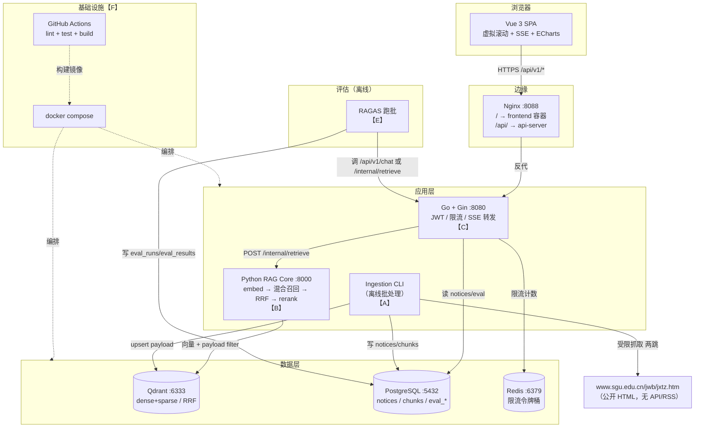
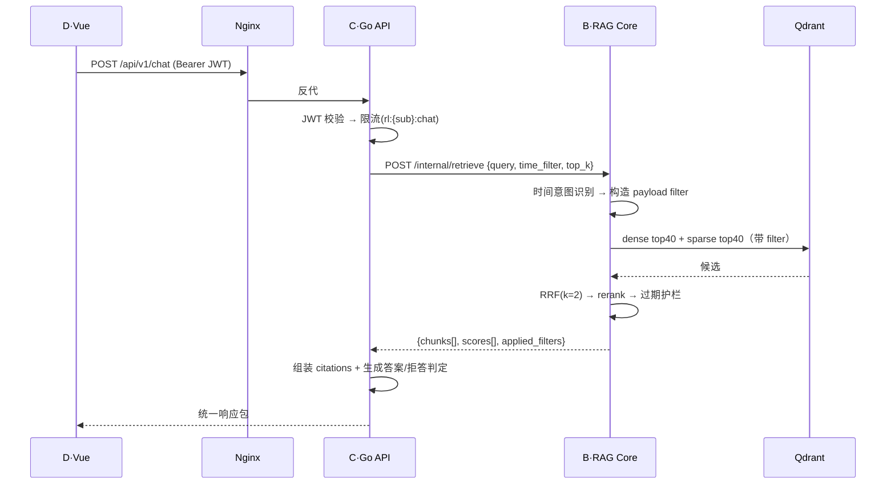
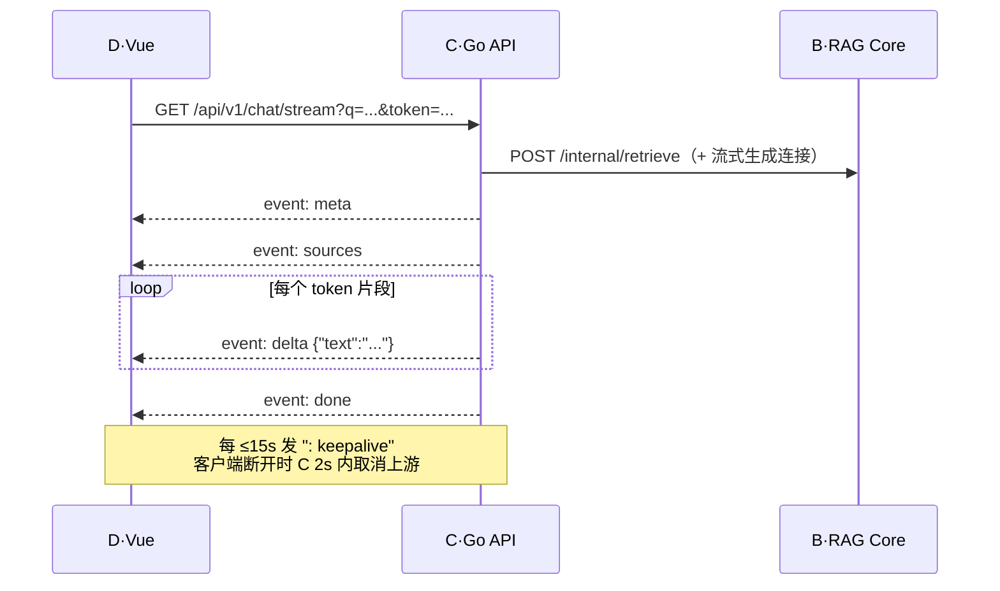

# 系统架构

---

## 1. 总体架构图



**关键边界**：

1. **前端只认 `/api/v1/*`**，不感知 RAG Core 的存在；跨域由 Nginx 收敛。
2. **C 不碰向量库**，B 不碰对外 REST：`POST /internal/retrieve` 是唯一的跨语言缝。
3. **A 是唯一写向量库的应用代码**（evaluate 只读）；B 只读 Qdrant，不建集合、不 upsert。
4. 采集是**离线批处理**，不挂在请求路径上，避免官网抖动传导到问答延迟。

---

## 2. 关键请求时序

### 2.1 非流式问答



### 2.2 SSE 流式问答



---

## 3. 模块目录 ↔ 六人分工映射

| 目录 | 成员 | 职责 | 对外边界 | 关键文件 |
|---|---|---|---|---|
| `ingestion/` | **A** | 受限抓取 → 解析 → 切块 → 元数据注入 → `chunks.jsonl` | 产出文件 + CLI | `ingestion/{cli,config,fetcher,pipeline}.py`、`ingestion/parsers/`、`ingestion/chunking/splitter.py`、`ingestion/temporal.py`、`ingestion/doc_registry.py`、`ingestion/emit/chunk_writer.py`（**下表关键文件一律相对该模块根目录**） |
| `rag-core/` | **B** | 嵌入、混合召回、RRF、Rerank、时间过滤、拒答 | `POST /internal/retrieve`、`GET /internal/health` | `app/main.py`、`app/retriever.py`、`app/time_filter.py`、`app/store.py`、`app/embedder.py`、`app/schemas.py` |
| `api-server/` | **C** | 对外 REST、SSE、JWT、限流 | `/api/v1/*`、`/healthz` | `cmd/server/main.go`、`internal/handler/`、`internal/middleware/` |
| `frontend/` | **D** | 列表虚拟滚动、SSE 问答、评估看板 | `/api/v1/*` 消费方 | `src/api/{client,chat,notices,eval,auth}.ts`、`src/views/`、`src/components/TimeBadge.vue` |
| `eval/` | **E** | 评估集、指标计算、RAGAS 回填、回归报告 | CLI + 写 `eval_*` 表 | `dataset/queries.jsonl`、`runner/metrics.py`、`runner/runner.py`、`runner/report.py`、`runner/cli.py` |
| `infra/` | **F** | compose、Nginx、CI、健康检查 | 一键启动 | `docker-compose.yml`、`nginx/`、`.github/workflows/` |

### 3.1 依赖方向（单向，无环）

```
frontend(D) ──HTTP──> api-server(C) ──HTTP──> rag-core(B) ──gRPC/HTTP──> qdrant
     │                     │                                              ▲
     │                     └──SQL──> postgres <──SQL── ingestion(A) ──────┘
     └──HTTP──> api-server(C) ──SQL──> postgres <──SQL── eval(E)
infra(F) ── 编排上述所有进程，不参与业务调用
```

**禁止的反向依赖**：B 调 C；C 直连 Qdrant；D 直连 B；A 调 C 的 REST；E 直接改 B 的代码。

---

## 4. 技术栈与选型理由

| 层 | 选型 | 版本 | 理由（简版，详见 ADR） |
|---|---|---|---|
| 前端 | Vue 3 + TS + Vite + Element Plus + ECharts | 3.5 / 6 / 2.8 / 5.5 | 10k 行列表虚拟滚动：首屏 1.68s→74ms，FPS 18→56，主线程阻塞 420ms→18ms（D） |
| API | Go + Gin | 1.23 / 1.10 | QPS 12k–30k；并发 1000 时 ~8,210 req/s（ADR-001） |
| RAG | Python + LangChain/LangGraph + bge-m3 + bge-reranker | 3.12 / 0.3 | 中文 dense+sparse 一体化、支持长文本 8192、生态成熟（ADR-002） |
| 向量库 | Qdrant | 1.17+ | 原生 dense+sparse + RRF(k=2)，无需自拼融合 |
| 关系库 | PostgreSQL | 16 | notices/chunks/eval_*，事务性一致 |
| 缓存 | Redis | 7 | 令牌桶限流，低成本高收益 |
| 评估 | RAGAS | 0.2+ | Faithfulness/Context Precision 可分离生成层与检索层故障 |
| 部署 | Docker Compose + Nginx | v2 / 1.27 | 六人项目，K8s 是负资产 |

---

## 5. 部署视图（compose 服务）

| 服务名 | 端口 | 镜像/构建 | 依赖 | 健康检查 |
|---|---|---|---|---|
| `frontend` | 5173→80 | `frontend/Dockerfile` | — | `GET /` |
| `api-server` | 8080 | `api-server/Dockerfile` | postgres、redis、rag-core | `GET /healthz` |
| `rag-core` | 8000 | `rag-core/Dockerfile` | qdrant | `GET /internal/health` |
| `qdrant` | 6333/6334 | `qdrant/qdrant:v1.12` | — | `GET /healthz` |
| `postgres` | 5432 | `postgres:16-alpine` | — | `pg_isready` |
| `redis` | 6379 | `redis:7-alpine` | — | `redis-cli ping` |
| `nginx` | 8088→80 | `nginx:1.27-alpine` | frontend、api-server | `GET /healthz` |

> 端口与健康检查路径是**冻结项**（`SKILL.md §6`），A—E 不得自行增删服务。

---

## 6. 非功能设计要点

| 关注点 | 设计 |
|---|---|
| 延迟预算 | p99 < 2s：JWT+限流 <5ms，retrieve ≤600ms，生成 ≤800ms，序列化 <20ms |
| 首 token | <1s：SSE 先发 `meta`+`sources`，生成与检索并行启动（检索完成即推 sources） |
| 限流 | Redis 令牌桶按 `sub`，避免单用户打满 |
| 降级 | RAG Core 不可用 → `50201`；Qdrant 不可用 → `/internal/health` 503，C 返回 `50301` |
| 幂等 | `content_hash` 去重，重跑采集不产生重复 chunk |
| 可观测 | 结构化日志（JSON）+ `latency_ms`/`retrieve_ms` 落日志字段；不做 APM |
| 安全 | 只抓公开页面；JWT 不落 localStorage 之外的存储；`.env` 不入库 |
