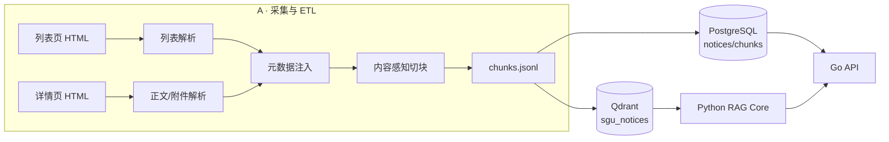

# 数据模型

> chunk 元数据的**权威定义**在 `.claude/skills/sgu-notice-rag-dev/references/data-model.md`。
> 本文件补充存储层 DDL、索引、时间过滤的工程实现与迁移约定。

---

## 1. 数据流总览



**单一事实源**：`chunks.jsonl`。Postgres 与 Qdrant 都是它的投影；两侧字段冲突时以 `chunks.jsonl` 为准，修复方式是从 jsonl 重灌。

---

## 2. 实体

### 2.1 Notice（文档级，一行一个版本）

同一事项的 2025 版和 2026 版是**两行**，通过 `supersedes_doc_id` 建立替代关系。

```sql
CREATE TABLE notices (
  doc_id              TEXT PRIMARY KEY,                         -- jwb-jxtz-2026-29459
  title               TEXT NOT NULL,
  publish_date        DATE NOT NULL,
  effective_from      DATE,
  effective_to        DATE,
  effective_precision TEXT NOT NULL DEFAULT 'unknown'
                      CHECK (effective_precision IN ('day','month','term','unknown')),
  doc_version         TEXT NOT NULL,                            -- v2026.1
  doc_version_rank    INTEGER NOT NULL,                         -- 202601
  is_current          BOOLEAN NOT NULL DEFAULT TRUE,
  supersedes_doc_id   TEXT REFERENCES notices(doc_id),
  content_type        TEXT NOT NULL
                      CHECK (content_type IN ('notice_body','attachment','table','appendix')),
  source_url          TEXT NOT NULL,
  topic_key           TEXT,                                     -- 主题聚类键，见 §2.3
  raw_html_path       TEXT,                                     -- 原始快照相对路径
  ingested_at         TIMESTAMPTZ NOT NULL DEFAULT now(),
  CONSTRAINT chk_effective_order CHECK (effective_to IS NULL OR effective_from IS NULL OR effective_to >= effective_from)
);

CREATE INDEX idx_notices_publish  ON notices (publish_date DESC);
CREATE INDEX idx_notices_current  ON notices (is_current, publish_date DESC);
CREATE INDEX idx_notices_topic    ON notices (topic_key, doc_version_rank DESC);
CREATE INDEX idx_notices_effective ON notices (effective_from, effective_to);
```

### 2.2 Chunk

```sql
CREATE TABLE chunks (
  chunk_id     TEXT PRIMARY KEY,          -- jwb-jxtz-2026-29459#c003
  doc_id       TEXT NOT NULL REFERENCES notices(doc_id) ON DELETE CASCADE,
  seq          INTEGER NOT NULL,          -- 文档内序号，从 1 开始
  section_path TEXT NOT NULL,
  content_type TEXT NOT NULL,
  text         TEXT NOT NULL,
  token_count  INTEGER NOT NULL,
  content_hash TEXT NOT NULL,             -- sha256(text)
  CONSTRAINT uq_chunk_seq UNIQUE (doc_id, seq)
);

CREATE INDEX idx_chunks_doc ON chunks (doc_id);
CREATE INDEX idx_chunks_hash ON chunks (content_hash);
```

> `title` / `publish_date` / `effective_*` / `doc_version` / `is_current` / `source_url` **不冗余**进 `chunks` 表，用 `JOIN notices` 获取；但 **Qdrant payload 必须冗余**（检索时无法 JOIN），冗余由 A 写入时保证一致。

### 2.3 topic_key（主题聚类键）

用于判定"同主题多版本"。生成规则（A 负责，实现见 `ingestion/ingestion/doc_registry.py` 的 `topic_key_of()`）：

1. 标题去除年份（`20\d{2}`）、去除"关于…的"外壳、去除标点与空白；
2. 剩余部分取前 24 个字符做归一化键；
3. 相同 `topic_key` 且 `doc_version_rank` 更大 → 较旧的可被标记 `is_current=false`（**必须同时满足**正文显式替代条件，见 §4）。

示例：
- `关于2026年转专业工作的通知` → `转专业工作的通知` → 与 `关于2025年转专业工作的通知` 同键。

### 2.4 评估表

```sql
CREATE TABLE eval_runs (
  run_id       TEXT PRIMARY KEY,          -- run-20261108-01
  created_at   TIMESTAMPTZ NOT NULL DEFAULT now(),
  dataset_size INTEGER NOT NULL,
  git_sha      TEXT,
  rag_config   JSONB NOT NULL,            -- 模型/阈值/融合参数快照
  metrics      JSONB NOT NULL,            -- 六项指标
  by_year      JSONB NOT NULL DEFAULT '[]'::jsonb,  -- /eval/summary 的 by_year 快照
  regressions  JSONB NOT NULL DEFAULT '[]'::jsonb   -- /eval/summary 的 regressions 快照
);

CREATE TABLE eval_results (
  run_id    TEXT NOT NULL REFERENCES eval_runs(run_id) ON DELETE CASCADE,
  query_id  TEXT NOT NULL,                -- q01
  answer    TEXT,
  refused   BOOLEAN NOT NULL,
  metrics   JSONB NOT NULL,               -- faithfulness / context_precision ...
  stale_hit BOOLEAN NOT NULL DEFAULT FALSE,   -- 该题是否命中过期 chunk
  citations JSONB,                        -- 引用列表快照
  category  TEXT,                         -- 可选：current_rule / cross_year_trap / ...
  as_of     DATE,                         -- 可选：评估基准日，by_year 按它分组
  PRIMARY KEY (run_id, query_id)
);
```

### 2.5 Qdrant collection

```
collection: sgu_notices
vectors:
  dense:  size=1024, distance=Cosine          # bge-m3 dense
sparse:
  sparse: BM25-ish 权重由 bge-m3 lexical weights 提供
payload schema（扁平，用于 filter）:
  chunk_id(str) doc_id(str) title(str) publish_date(date str)
  effective_from(date str|null) effective_to(date str|null)
  doc_version(str) doc_version_rank(int) section_path(str)
  content_type(str) source_url(str) is_current(bool)
  supersedes_doc_id(str|null) topic_key(str|null)
indexes:
  publish_date      -> datetime
  effective_to      -> datetime
  is_current        -> bool
  doc_version_rank  -> integer
  content_type      -> keyword
```

**创建命令**（B/F 共用，写进 `infra/scripts/init-qdrant.sh`）：

```bash
curl -s -X PUT "http://qdrant:6333/collections/sgu_notices" \
  -H 'Content-Type: application/json' \
  -d '{"vectors":{"dense":{"size":1024,"distance":"Cosine"}},
       "sparse_vectors":{"sparse":{}}}'
```

---

## 3. 时间过滤生效顺序（不可调整）

```
(0) 入参归一：as_of = time_filter.as_of ?? 今天(Asia/Shanghai)
(1) 时间意图识别  rag-core/app/time_filter.py
      intent ∈ current | historical | deadline | none
      产出 date_from / date_to（可能为 null）
(2) 硬过滤（Qdrant payload filter，检索前）
      publish_date <= as_of
      AND (effective_to IS NULL OR effective_to >= as_of)
      mode=range 时追加 publish_date >= date_from / <= date_to
      mode=off  → 跳过整个 (2)，applied_filters 记 []
(3) 混合召回 dense top40 + sparse top40
(4) RRF 融合（Qdrant 原生，k=2）
(5) Rerank top20 → top8
(6) 过期护栏：intent=current 时对 is_current=false 的 chunk 分数 ×0.5；若仍在前 top-3，剔除并记入 stale_hit 日志
(7) 生成 or 拒答（阈值见 eval/thresholds.json）
```

**为什么 (2) 必须在 (3) 之前**：过滤在召回前，候选池本身不含过期文档，旧版本不可能靠"语义更像"抢占 top-k；若先召回后过滤，top-40 一旦被旧版本占满，过滤后只剩个位数候选，召回质量塌陷。

**评测口径依赖**：`applied_filters` 为空数组 ⇔ 未做时间过滤，E 用它区分"有过滤/无过滤"两次跑批。

---

## 4. 元数据判定规则（A 的实现口径）

| 字段 | 规则 | 失败时 |
|---|---|---|
| `publish_date` | 优先详情页"发布时间"；无则用列表页日期 | 列表页必有，不允许 null |
| `effective_from` | 正文"自 X 起"、"X 日起" | null，precision=`unknown` |
| `effective_to` | 正文"至 X 止"、"截至 X"、"X 前" | null（表示长期有效） |
| `precision` | 显式日期→`day`；"X 月"→`month`；"本学期"→`term` | `unknown` |
| `is_current` | 同 `topic_key` 存在更高 `doc_version_rank`，**且**新版正文含"废止/替代/新版执行"字样 | 保持 `true`（宁可多留，不可错杀） |
| `supersedes_doc_id` | 上述条件成立时，新版指向旧版 | null |
| `doc_version` | `v{publish_year}.{同年序号}` | 必填，无失败路径 |
| `content_type` | 正文段落→`notice_body`；pdf/doc 附件→`attachment`；表格→`table`；附录→`appendix` | 默认 `notice_body` |

**禁止**：用标题相似度直接判定 `is_current=false`；用 `1970-01-01` 等哨兵值表达未知。

---

## 5. 迁移与版本

| 变更类型 | 处理 |
|---|---|
| 新增可选字段 | bump `schema_version` from→to，写迁移脚本 `ingestion/migrations/00X_*.py`，重灌 jsonl |
| 改字段名/类型 | 契约变更：`SKILL.md §1` 三步流程 + E 全量回归 |
| 重建集合 | `infra/scripts/reset-qdrant.sh`（仅本地），生产走 alias 切换 |

`schema_version` 每行 `chunks.jsonl` 都写，当前 `"1.0"`。

---

## 6. 示例 `chunks.jsonl`（两行）

```json
{"schema_version":"1.0","chunk_id":"jwb-jxtz-2026-29459#c001","doc_id":"jwb-jxtz-2026-29459","title":"关于2026年转专业工作的通知","publish_date":"2026-03-04","effective_period":{"from":"2026-03-04","to":"2026-05-31","precision":"day"},"doc_version":"v2026.1","doc_version_rank":202601,"section_path":"正文 > 一、报名安排","content_type":"notice_body","source_url":"https://www.sgu.edu.cn/jwb/info/1050/29459.htm","text":"关于2026年转专业工作的通知\n一、报名安排\n……报名截止时间为4月10日17:00，逾期不再受理。","token_count":412,"content_hash":"9f2c...","supersedes_doc_id":"jwb-jxtz-2025-29001","is_current":true,"ingested_at":"2026-11-08T14:00:00+08:00"}
{"schema_version":"1.0","chunk_id":"jwb-jxtz-2025-29001#c004","doc_id":"jwb-jxtz-2025-29001","title":"关于2025年转专业工作的通知","publish_date":"2025-03-06","effective_period":{"from":"2025-03-06","to":"2025-05-30","precision":"day"},"doc_version":"v2025.1","doc_version_rank":202501,"section_path":"正文 > 一、报名安排","content_type":"notice_body","source_url":"https://www.sgu.edu.cn/jwb/info/1050/29001.htm","text":"关于2025年转专业工作的通知\n一、报名安排\n……报名截止时间为4月11日17:00。","token_count":398,"content_hash":"3b71...","supersedes_doc_id":null,"is_current":false,"ingested_at":"2026-11-08T14:00:00+08:00"}
```

---

## 7. 保留与清理

- 原始 HTML 快照保留 90 天（`ingestion/data/raw/`），用于解析回归。
- `chunks.jsonl` 每次全量覆盖，历史版本按 `ingested_at` 归档到 `ingestion/data/archive/{date}/`。
- 评估结果永久保留（体积小），用于趋势对比。
